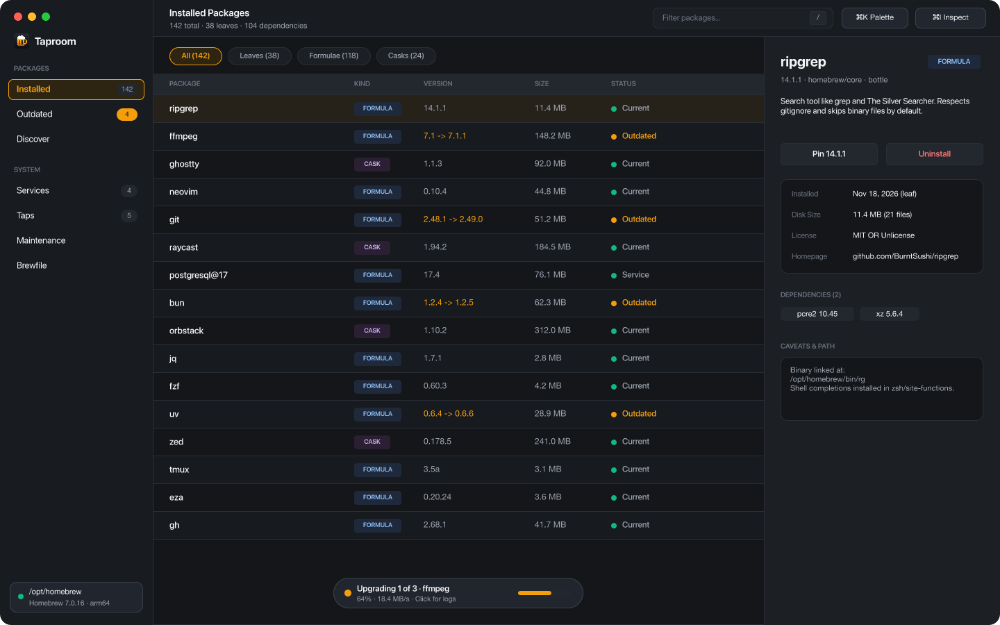
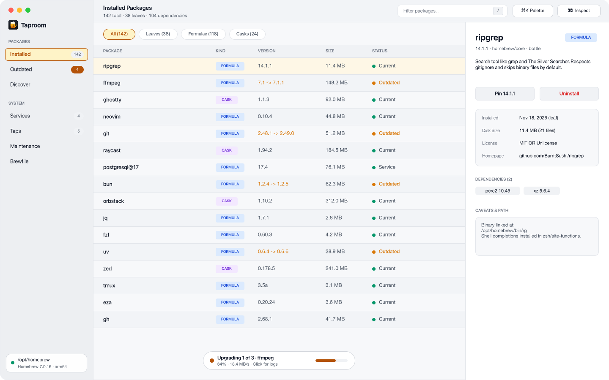

# Taproom

Native macOS 26 (Tahoe) Homebrew cockpit built with SwiftUI, Liquid Glass navigation chrome, and SQLite FTS5.

<p align="center">
  
  
</p>

## Requirements

- macOS 26.0+ (Tahoe)
- Homebrew (`/opt/homebrew/bin/brew` or `/usr/local/bin/brew`)
- Xcode 16+ and `xcodegen` (`brew install xcodegen`)

## Features

- **Installed catalog**: Sortable table of formulae and casks with Cellar/Caskroom disk sizes, leaf/dependency filters, and a right-hand inspector (`⌘I`).
- **Dependency graph**: Clickable dependency and reverse-dependency (`Required By`) chips in the inspector, plus dependent warnings before uninstall.
- **Outdated & greedy casks**: Upgrade individual packages or all outdated packages (`⌘U`), with an optional `--greedy` toggle for auto-updating casks.
- **Cask zap & confirmations**: Destructive actions (`Uninstall`, `Uninstall & Zap`, `Untap`, `brew cleanup`, `brew autoremove`) prompt for confirmation.
- **FTS5 discovery**: Local SQLite FTS5 BM25 search across `formulae.brew.sh` metadata (with offline cache-name fallback).
- **Adopt existing apps & Rosetta audit**: Scan `/Applications` and `~/Applications`, flag Intel (`x86_64`) apps running under Rosetta, and adopt unmanaged apps via `brew install --cask --adopt`.
- **Services, taps, maintenance, Brewfile**: Start/stop/restart `brew services`, manage taps, run `brew doctor` and `brew missing`, inspect operation history, export or import `Brewfile`s, and control updates from the menu bar extra.
- **Command palette**: `⌘K` fuzzy launcher with keyboard navigation across actions, views, services, and installed packages.
- **Serial mutation queue**: FIFO `brew` runner with live ANSI-stripped log streaming (`⌘L`), cancellation, custom `brew` binary/proxy overrides, and `SUDO_ASKPASS` elevation.

## Build and Run

```sh
git clone git@github.com:AungMyoKyaw/taproom.git
cd taproom
make run
```

Common targets:

- `make build`: Generate `Taproom.xcodeproj` via `xcodegen` and build `Taproom.app`.
- `make run`: Build and open `.build/Build/Products/Debug/Taproom.app`.
- `make dev`: Build and run the binary in the foreground.
- `make test`: Run the Swift Testing suite.
- `make dmg`: Build Release and package `Taproom.app` into `.build/Taproom.dmg`.
- `make notarize`: Build DMG, notarize via `notarytool`, staple, and verify Gatekeeper.

## Architecture

- `Sources/App/`: `TaproomApp`, `AppState` (`@Observable` + `UserDefaults` persistence), and `Theme` (`DESIGN.md` tokens).
- `Sources/Core/`: `LiveBrewRunner` (`brew` subprocess wrapper + login-shell `HOMEBREW_*` env), `BrewOutputParser`, `CatalogStore` (GRDB SQLite FTS5), `MutationQueue` (FIFO queue), and `AskpassHelper`.
- `Sources/Models/`: `BrewPackage`, `BrewServiceInfo`, `BrewTapInfo`, and `MutationJob`.
- `Sources/Views/`: SwiftUI views for the `NavigationSplitView` cockpit, inspector, command palette, live log viewport, and menu bar extra.

## License

[MIT](LICENSE)
